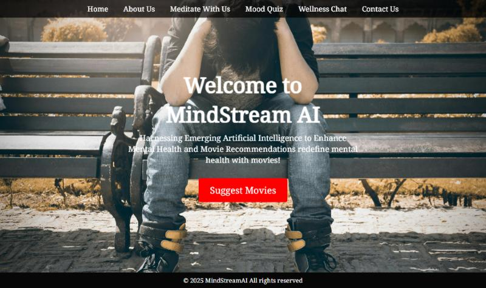
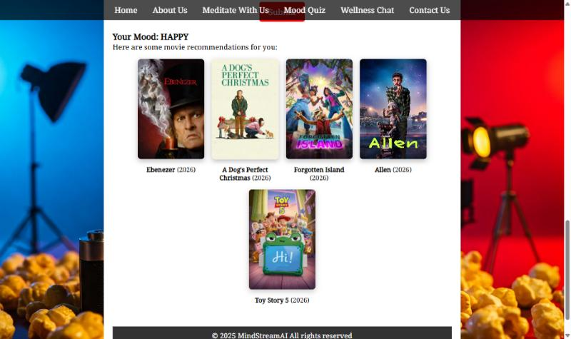
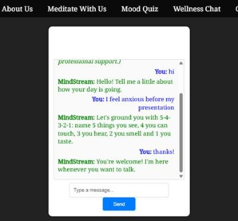

# MindStream: Mood-Based Wellness & Movie Recommendation Web App 🎬🧘

MindStream is a wellness web app built on the idea that what we watch and how we unwind affects how we feel. A short
**mood quiz** works out your dominant mood and recommends **live, mood-matched movies from TMDB**. A
**meditation library** and a **wellness chat** help when a movie isn't enough.




## Features

| Page | What it does |
|---|---|
| **Mood Quiz** (`generate.html`) | 10 questions → dominant mood (happy, stressed, anxious, tired) → 5 popular movies from a mood-matched genre, with posters, via the TMDB API |
| **Wellness Chat** (`quiz.html`) | A rule-based companion that runs in the browser. It recognises topics like stress, anxiety, low mood, sleep and anger, and suggests simple self-care techniques (box breathing, 5-4-3-2-1 grounding, sleep hygiene) |
| **Meditate With Us** (`recipe.html`) | A curated library of ~20 guided meditation, breathing and relaxation videos |
| **About / Contact** | Project background and contact form |


*Mood quiz → "happy" → live comedy recommendations from TMDB.*

## How it works

**Mood → movies.** Each answer maps to a mood, and the most frequent mood picks a genre. The app then calls TMDB's
`discover/movie` endpoint, sorted by popularity:

| Mood | Genre |
|---|---|
| Happy | Comedy |
| Stressed | Adventure |
| Anxious | Romance |
| Tired | Animation |

Horror and thriller are always excluded and adult content is filtered out, since this is a wellness app.

**Wellness chat.** The chat is deliberately simple and transparent: keyword topics → hand-written, evidence-informed
suggestions, with no external service. If a message mentions self-harm or suicide, it **always** answers first with
crisis contacts (Tele-MANAS **14416**, India, free and 24x7; emergency **112**). User input is HTML-escaped before it is
displayed.



## Run it

1. Get a free API key from [TMDB](https://www.themoviedb.org/settings/api).
2. Copy `config.example.js` to `config.js` and paste the key. `config.js` is git-ignored, so the key is never committed.
3. Serve the folder and open it:
   ```bash
   python -m http.server 8000      # then visit http://localhost:8000
   ```

## Notes & limitations

- **MindStream is not a medical or crisis service.** The chat gives general self-care suggestions only.
- The mood quiz is a simple scoring heuristic, not a clinical assessment.
- In a purely static site the API key is visible in the browser. For a public deployment, requests should go through a
  small backend.
- Movie data and posters are provided by [TMDB](https://www.themoviedb.org/). This product uses the TMDB API but is not
  endorsed or certified by TMDB.

## Author

**Shubhreeka Saxena**, B.Tech AI & ML, VIPS-TC (GGSIPU)
[LinkedIn](https://www.linkedin.com/in/shubhreeka-saxena/) · [GitHub](https://github.com/shubhreeka)
